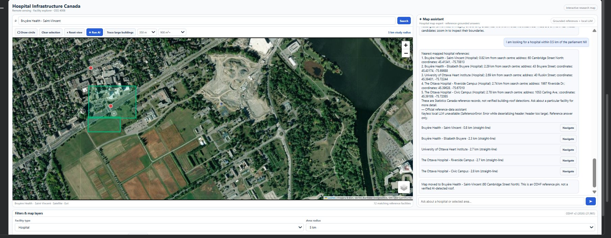
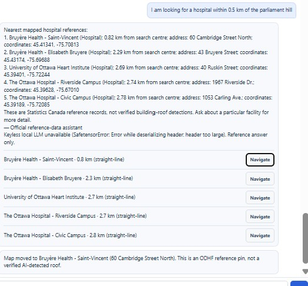

# Hospital Infrastructure in Canada

**OSS 4008 — Remote Sensing and Applications | Carleton University | Updated November 23, 2026**

An interactive, Colab-native prototype for exploring **Canadian hospital reference locations** and testing AI-assisted identification of possible hospital buildings in high-resolution overhead imagery.

**Project status: Working reference-map and navigation demo; experimental building detection and map-derived footprint tracing.** The program is **not** a medically verified hospital finder, a comprehensive nationwide image detector, or an independently validated hospital-building classifier.

## Application preview



*Live Colab map screenshot: the red points are Statistics Canada reference locations; the green boxes are unverified image-model candidates. Some boxes may include parking areas or miss real hospital roofs.*



*Hospital search and navigation screenshot. This screenshot was captured **before** the strict distance-filter code fix: the 0.5 km query visibly included a result at 0.82 km. The corrected radius-filter code is now included but requires a fresh live Colab check.*

## Launch the map

**[Open Notebook 01 — Final hospital map in Google Colab](https://colab.research.google.com/drive/1YYpGBo-imloznVD9yRzQ4zDmC7EwVOuJ)** and choose **Runtime → Run all** (the two code cells). The compact interactive map opens directly in the notebook. **No Gradio server and no retraining are needed to view the app.** The dashboard retains the approved `SCREEN_MARGIN_PX=65` layout.

The notebook reads official reference records, saved imagery and any previously trained experimental checkpoint from the user's Google Drive folder `MyDrive/OSS4008_Hospital_AI_Pilot` (not included in this public repository). You may need to authorize the Google Drive mount. Network access is needed for map imagery, some landmark searches and mapped building data.

## What users can do now

- **Search Canadian cities and towns** such as Ottawa, Kitchener, Vancouver or Toronto and explore known facilities on the satellite or street basemap. Choose facility type and a **5–100 km reference search radius**, or draw a study circle.
- **Ask for hospitals near landmarks.** The assistant can find mapped hospitals around named Canadian places such as **Parliament Hill in Ottawa**, **Victoria Park in Kitchener**, or **downtown Vancouver**. A typical question is: *“Show hospitals within 1 km of Parliament Hill.”* A **500 m** query is supported by the updated strict-radius parser. Results use **straight-line geographic distance**, not road travel time, and depend on successful landmark lookup and the underlying reference database. The screenshot above predates the correction; live Colab verification of the exact-radius filter is still pending.
- **Navigate directly from chat.** Each returned hospital reference has a **Navigate** button. Clicking it centres and zooms the map on the selected **official reference pin** (not a verified roof or a driving route).
- **Inspect experimental green AI bounding boxes.** The Ontario image pilot runs a weakly supervised YOLO model on licensed aerial image chips **near known hospital reference sites** (up to 24 sites per city query). It is **not** scanning every building in a city. Green rectangles represent tentative model detections and do **not** prove the buildings are hospitals.
- **Trace nearby mapped buildings in amber.** Select a red pin or draw a **20–350 m circle**, choose a radius (100/180/250/350 m near a pin) and minimum mapped building footprint area (500/900/1500/2500 m²), then select **Trace large buildings**. The backend requests building polygons from **OpenStreetMap** with an **Overture Maps** fallback. These amber boundaries reflect mapped geometry near a reference coordinate, **not AI roof segmentation and not confirmed hospital use**. Source availability varies; a missing outline is reported rather than invented.
- **Ask the map assistant about known facilities.** Hospital names, addresses, coordinates, distances and Navigate targets come from the loaded **Statistics Canada ODHF** records, not from fabricated language-model coordinates. A small open-weight **Qwen2.5-0.5B-Instruct** LLM is configured for keyless conversation, and **Gemini 2.5 Flash-Lite** may be enabled with a `GEMINI_API_KEY` Colab Secret. In a recent test Qwen failed to load with `SafetensorsError: Error while deserializing header: header too large`; the app transparently returned a **reference-only non-generative answer**. Generative chat should therefore **not be considered reliably live** until the model is re-tested.

## How the AI and building overlays work

| Map visual | Data source / method | Interpretation |
| --- | --- | --- |
| **Red pin** | Statistics Canada Open Database of Healthcare Facilities (ODHF) | Known *reference location*, not an AI detection; a pin may lie on a road next to a building |
| **Green rectangle** | Experimental YOLO rooftop-candidate model, trained on OSM/Overture **pseudo-labels** and run against licensed Ontario imagery | Unverified image-model prediction, approximate rectangular box; false positives and false negatives are visible |
| **Amber footprint** | OpenStreetMap / Overture mapped building polygons near the reference or drawn circle | Existing geographic building geometry, **not** an image-model result or confirmation of hospital use |

The current green-box size screen (minimum bounding-box area **750 m²** and shorter side **16 m**) reduces some residential false positives but may also hide actual hospital wings. Parking lots, roof shapes, helicopter pads, height and tree coverage have **not** been separately trained as validated indicators of hospital function. The detector can incorrectly outline parking lots or miss large complexes. **No independently verified precision/recall or hospital-identification accuracy is available.** Weak-label test scores cannot be represented as real-world hospital accuracy.

The mapped-footprint workflow can return true building polygons when the source includes them; it cannot create an accurate outline directly from arbitrary aerial-image pixels. Hospital function remains unverified until independently checked.

## Project layout

```text
students/hamza_arab/
├── README.md
├── screenshots/
│   ├── hospital_map_overview.jpg
│   └── hospital_chat_navigation.jpg
└── code/
    ├── notebooks/
    │   ├── 01_final_hospital_map.ipynb      # launch the application
    │   ├── 02_publish_to_github.ipynb       # publish ONLY this student folder
    │   └── 03_ai_research_training.ipynb    # optional imagery / training lab
    └── app/                              # Python sources, dependencies and focused tests
```

The Drive project mirrors these top-level folders; `01_Notebooks` and `02_App` are retained there. The older documentation/archive folders, unused tiny data schema and empty results placeholder have been removed from the active project folder. **Do not delete** the separate persistent `MyDrive/OSS4008_Hospital_AI_Pilot` folder; it holds source imagery, manifests, experimental weights, caches and annotation evidence.

## Current progress and limitations

| Area | Status as of Nov 23, 2026 |
| --- | --- |
| Colab inline Leaflet/satellite map, reference pins, study filters | **Implemented; seen working in real screenshots** |
| Hospital chat reference search + Navigate buttons | **Implemented; observed live** |
| Exact *within 500 m / 1 km* location filtering | **Code corrected, tests pass; live retest pending** |
| Experimental YOLO prediction boxes around Ontario reference sites | **Inference observed live; detection accuracy unverified** |
| Radius-based OSM/Overture amber polygon tracing | **Implemented; offline tests pass; real provider coverage still unreliable/unverified** |
| Keyless local Qwen LLM | **Configured but load failed in user test; reference-only fallback observed** |
| Independent hospital detection evaluation and nationwide image inference | **Pending** |
| Class GitHub publication of the cleaned folder | **This release is prepared for publication; verify repository commit** |

### Reproducibility and research notes

[Notebook 03 — AI Research & Training](https://colab.research.google.com/drive/10XRLKxphj6VG0uAESCGksxcO_iJ2_cDX) contains the optional orthophoto acquisition, OSM/Overture weak annotation proposals, review/validation tools, training and site-split evaluation. It should **not** be rerun automatically during ordinary map usage. Real-world accuracy requires independently verified positive/negative buildings, held-out sites, systematic error analysis and a documented imagery licence. Course instructors determine whether the pilot meets all OSS 4008 deliverables.

[Notebook 02 — GitHub Publishing](https://colab.research.google.com/drive/1kOQEplHtjr9W3QChwOf0D8bhSX9i7JI4) is an alternative controlled publishing method. It uses a hidden token prompt and is restricted to `students/hamza_arab/`; **never push or edit other students' work**.

**Data attribution:** Statistics Canada ODHF v2 (2026); Esri and underlying satellite imagery providers displayed in the map; OpenStreetMap and Overture Maps with their applicable licences. Screenshots here were provided by the project author and depict experimental features, not verified medical advice.

**Project progress record:** [Master Progress (Google Docs)](https://docs.google.com/document/d/19Paw2MMlCWBhAub5WZxuL5i6IXSeOX4IxL02t_ogUKA/edit).
