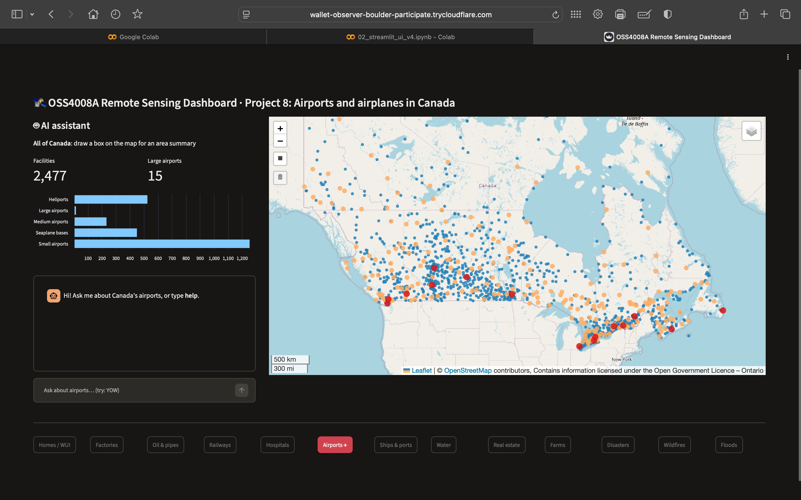
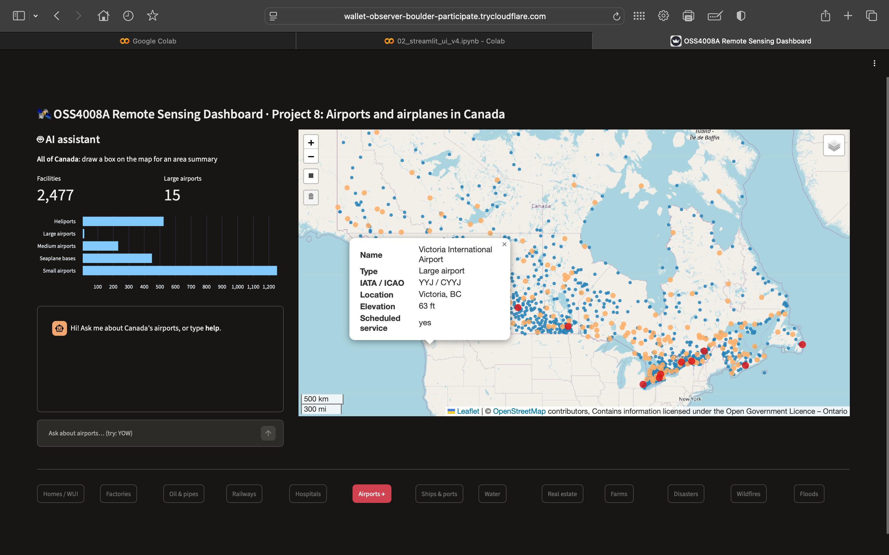
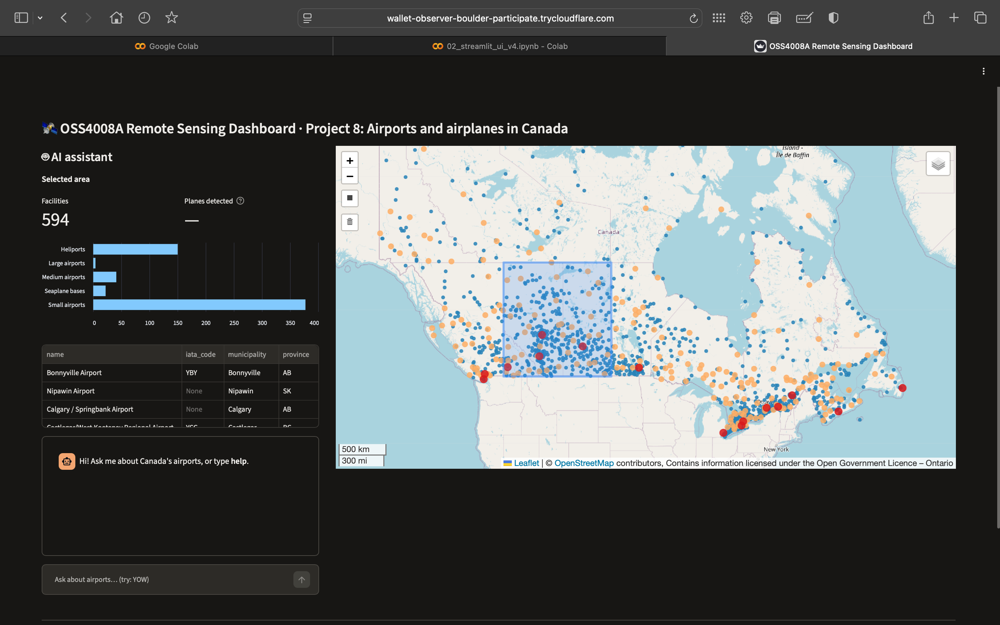
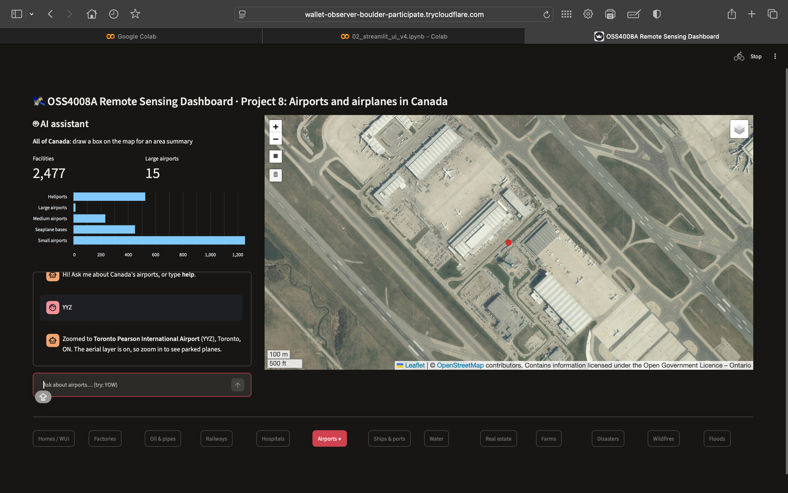
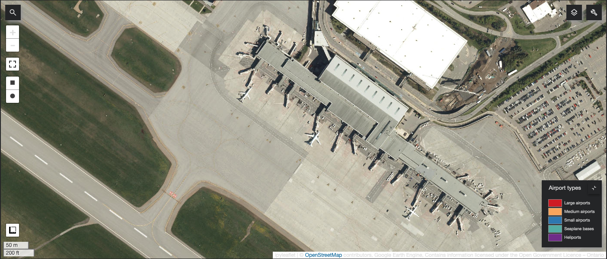
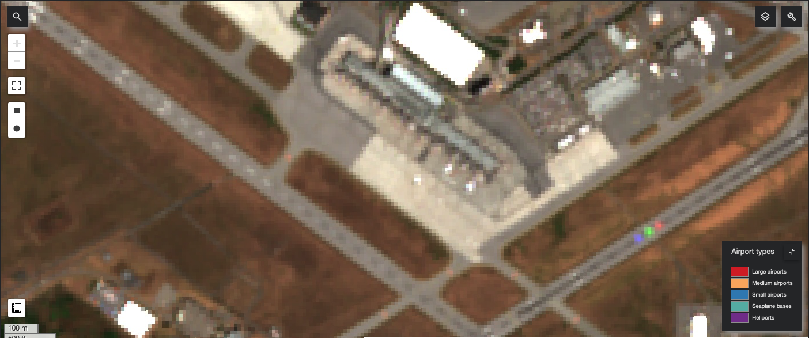

# Progress 2 Update – Project 8: Airports and airplanes in Canada

**Student:** Nifemi Ogunmeru | **Course:** OSS4008A – Introduction to Remote Sensing and Applications
**Date:** November 12, 2026 | **Covers:** work since Progress 1 (October 19)

---

## 1. Summary of work completed since Progress 1

| Date | Work |
|---|---|
| Oct 19 | Progress 1 review. Project approved; the RA asked me to look further into **airplane detection** using imagery better than Sentinel-2. |
| Oct 19–25 | Imagery survey for airplane detection. A Boeing 737 (~40 m) is only about 4 pixels in Sentinel-2 (10 m), too coarse to detect. Candidates compared: PlanetScope (~3 m), Planet SkySat public sample in Earth Engine (0.8 m, 2014–2016), Ontario open aerial imagery (16–50 cm). |
| Oct 27 – Nov 4 | Moved the project into the course repository (`students/nifemi_ogunmeru/`). Uploaded notebook 01 (verified to run top to bottom in Colab), the cleaned dataset (2,477 Canadian airports, heliports and seaplane bases), the project plan and the weekly progress log. |
| Nov 4–7 | Added **Ontario aerial imagery (~20 cm per pixel)** to the map: parked aircraft are clearly visible at Ottawa airport (YOW). Compared it with the clearest summer 2025 Sentinel-2 image of the same airport, where planes are only blurry blobs (see section 4). Packaged the map in one function, `build_airport_map()`. |
| Nov 9 | Progress 2 review (no demo possible; Colab was down). The RA accepted an Ontario focus for plane detection if no better combination of open datasets exists, and pointed to the course UI draft. |
| Nov 9 | Second dataset survey (Quebec, Calgary, Edmonton, New Brunswick, Saskatchewan, BC, US NAIP). **Decision:** deploy plane detection on Ontario imagery; train on Ontario plus a few US airports from NAIP (0.6 m, public domain, in Earth Engine). |
| Nov 9 | **Built the dashboard** (`code/02_streamlit_ui.ipynb`) following the course's *Draft for the project UI schema*, then made it much faster (details in section 4). |

## 2. Status of the user interface (UI)

**The UI has been developed and is working.** It is a Streamlit web app that runs on Google Colab (Runtime → Run all, then open the link printed by the last cell).

| Part of the course UI draft | Status | In the dashboard |
|---|---|---|
| Left: AI-based data analysis, graphs, dashboard | ✅ Built | **AI assistant panel:** Canada-wide statistics and a bar chart by facility type; a summary of any area drawn on the map; a chat box |
| Right: interactive map (zooming, clicking on a pixel → information, drawing a box) | ✅ Built | Map of all 2,477 facilities in 5 colour-coded layers, click for details, draw-a-box area summary, Ontario aerial imagery when zoomed in |
| Bottom: one button per project | ✅ Built | 13 buttons, one per class project; the Airports button is active |
| AI model detecting targets in a drawn box | ⏳ In progress (due Nov 23) | A "Planes detected" box is already in the panel, waiting for the trained model |

**Current limits (honest status):**
- The chat assistant is **rule-based** for now (fixed commands, listed below). It will report the plane-detection results once the model is connected.
- Sharp aerial imagery is available for **Ontario only** (no free national source exists). The airport map itself covers all of Canada.
- The app link works while the Colab session is open (a new link is created each session).

## 3. Interactive buttons and controls

### Project buttons (bottom row)

Visible along the bottom of the overview screenshot at the top of this document.

| Button | Function |
|---|---|
| **Airports ✈** (Project 8, highlighted) | Reloads the Project 8 map at the national view (all of Canada), as the course document describes for project buttons |
| Homes / WUI, Factories, Oil & pipes, Railways, Hospitals, Ships & ports, Water, Real estate, Farms, Disasters, Wildfires, Floods | Placeholders for the other class projects (greyed out). They will load each project's map when the projects are merged into the shared tool |

### Map controls (right)

| Control | Function |
|---|---|
| **Zoom + / −** (top left) and mouse wheel | Zoom in and out. From zoom level 12 (airport scale) the Ontario aerial imagery appears automatically |
| **Click an airport dot** | Popup with name, type, IATA / ICAO codes, location, elevation and scheduled service ("clicking on pixel → provide information" in the draft) |
| **Hover over a dot** | Shows the airport name |
| **Draw a rectangle** (square icon, left toolbar) | Selects an area. The left panel then shows the number of facilities inside, a bar chart by type, and a table of the large and medium airports in the box ("drawing a box" in the draft) |
| **Layers menu** (top right) | Switch each layer on or off: large airports, medium airports, small airports, seaplane bases, heliports, and the Ontario aerial imagery |

### AI assistant (left)

| Command typed in the chat | What it does |
|---|---|
| `help` | Lists what the assistant understands |
| An airport code, e.g. `YOW`, `YYZ`, `CYOW` | Zooms the map to that airport. In Ontario, the aerial imagery shows the parked planes |
| `how many airports in ON` (or a province name) | Number of active facilities in that province |
| `how many heliports` (or large / medium / small / seaplane) | Number of facilities of that type in Canada |
| `reset` | Returns the map to all of Canada |

## 4. Challenges and solutions

| Challenge | Solution |
|---|---|
| Sentinel-2 (10 m) cannot show individual planes | Switched the imagery to open **Ontario aerial imagery (~20 cm)**. Comparison at YOW below: planes are clear at 20 cm and only blobs at 10 m. A moving aircraft even appears as a red-green-blue streak in Sentinel-2, because its colour bands are captured a fraction of a second apart. |
| No free, current, sub-metre imagery covers all of Canada (BC is paid, Saskatchewan is members-only) | Plane detection as a case study on Ontario airports, with extra training examples from US NAIP (allowed by the course document when Canadian data is missing). Quebec, Calgary and Edmonton recorded as future improvements. |
| Colab's built-in app link did not work with Streamlit | Public link through a free Cloudflare quick tunnel, created automatically by the notebook |
| The first dashboard version was very slow | 2,477 separate markers replaced by 5 compact GeoJSON layers drawn on a canvas; the map is built once and reused; buttons and chat are handled before the map is drawn, so each action runs the page only once |
| After a page refresh the map collapsed to a thin strip | Caused by reusing the same saved map object; fixed by drawing a fresh copy of it on each run |

| Ontario aerial imagery (~20 cm) | Sentinel-2 (10 m), same airport |
|---|---|
|  |  |

## 5. Next steps (to Progress 3, November 23: "UI with AI integrated")

1. **Labelled plane dataset:** image chips around Ontario airports (and a few US NAIP airports); planes annotated with LabelMe (`images/` and `annotations/` folders, as in the course document).
2. **Train a plane detector** (pretrained object-detection model, fine-tuned in PyTorch on a Colab GPU), with accuracy measured on images it has not seen.
3. **Connect the model to the dashboard:** draw a box on the map → the model detects the planes in it → boxes drawn on the map, and the count shown in the "Planes detected" panel.
