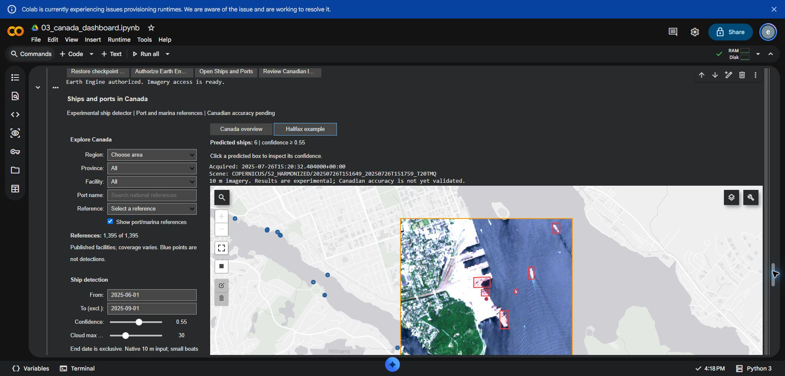

# Ships and Ports in Canada

**Student:** Oritse-Tsegbemi Eyito  
**Course:** OSS4008A - Introduction to Remote Sensing and Applications

## Quick start for the November 23 demo

1. Open [Notebook 03 in Colab](https://colab.research.google.com/github/AdityaR28/OSS4008A---Introduction-to-Remote-Sensing-and-Applications/blob/main/students/oritse-tsegbemi_eyito/code/03_canada_dashboard.ipynb). Use **Runtime > Run all**. A CPU runtime is sufficient.
2. Click **Load published demo files**. Colab retrieves the verified checkpoint and example outputs from the course repository.
3. For the archived demo, select the July 26 Halifax or August 12 Vancouver entry under **Saved run**. The map and PNG work without Earth Engine authorization.
4. For the live demo, set `EE_PROJECT` in the dashboard cell to a Google Cloud project you can access and click **Authorize Earth Engine**. Choose **Halifax example**, then **Load imagery** and **Detect ships**. Click a box to inspect its score. Choose **Vancouver (Pacific)** for the second case.

The [current dashboard screenshot](results/dashboard_ui_preview.jpg), [bottom project bar](results/dashboard_ui_footer.jpg), and [eight-check UI report](results/dashboard_ui_checks.json) document the current interface.

Saved evidence is available during a runtime interruption. Open the [Halifax preview](results/ships_2025-07-26_ccc66456ac88.png), [Vancouver preview](results/ships_2025-08-12_f33c2c479429.png), or [live run metadata](results/nov23_live_rehearsal.json). Predictions are experimental.

## Project objective

Develop a reproducible Python workflow in Google Colab to detect ships in satellite imagery and display predictions on an interactive Canadian map.

**Dashboard notebook:** [03_canada_dashboard.ipynb in Colab](https://colab.research.google.com/github/AdityaR28/OSS4008A---Introduction-to-Remote-Sensing-and-Applications/blob/main/students/oritse-tsegbemi_eyito/code/03_canada_dashboard.ipynb).
The standalone dashboard connects Earth Engine imagery, the existing trained vessel
detector and an interactive Canada map. The shared course UI connection is pending.

Halifax Harbour is the initial demonstration area. Additional functional checks cover Vancouver and Montreal. Port markers are published reference points, separate from ship predictions; port detection and boundary mapping are not implemented.

## Folder structure

```text
students/oritse-tsegbemi_eyito/
├── README.md
├── code/
│   ├── 01_halifax_harbour_baseline.ipynb
│   ├── 02_ships_ports_detection.ipynb
│   ├── 03_canada_dashboard.ipynb
│   └── supporting Python modules
├── data/
└── results/
```

The notebooks generate supporting Python modules, dataset records and outputs inside this folder. The training data download is documented in notebook 02. Notebook 03 uses the preserved checkpoint for the demonstration.

## Notebooks

### 01_halifax_harbour_baseline.ipynb

Establishes the initial Halifax imagery workflow:

- Connects to Google Earth Engine.
- Searches Sentinel-2 imagery.
- Selects a dated observation.
- Displays imagery and reports coverage.
- Saves image records, study-area geometry, metadata and a PNG preview.

### 02_ships_ports_detection.ipynb

Implements the detection and assessment workflow:

- Downloads and verifies an existing annotated vessel dataset.
- Converts source bounding boxes to Labelme rectangle JSON.
- Separates training, validation and test images by geographic tile.
- Fine-tunes a PyTorch Faster R-CNN detector.
- Evaluates predictions on held-out images.
- Connects satellite imagery retrieval to model inference.
- Displays ship predictions on a Canada-centred interactive map.
- Saves PNG, CSV, GeoJSON and scene metadata.
- Produces error reports and validation threshold comparisons.
- Downloads Canadian aerial imagery for separate annotation review.

### 03_canada_dashboard.ipynb

Opens the current meeting dashboard with the trained detector, national references, analysis charts, map selection, and saved results. **Load published demo files** restores the verified checkpoint, example runs, and English Bay and Saint John review inputs. **Review Canadian labels** opens the unannotated Saint John scene.

## Data and model

The training source is the SEN2MS Vessel Bounding Boxes dataset by Earle and Seto, distributed under CC BY 4.0:

https://doi.org/10.5281/zenodo.15571607

The prepared dataset contains:

| Partition | Images | Ship boxes |
| --- | ---: | ---: |
| Training | 1,430 | 935 |
| Validation | 544 | 320 |
| Test | 399 | 89 |
| Total | 2,373 | 1,344 |

Images are grouped by source MGRS tile before splitting. Exact RGB duplicates are removed, and source cloud categories above 1 are excluded.

Training samples are balanced between positive and negative images. Validation and test retain their eligible images.

The detector uses an ImageNet-pretrained ResNet18 backbone with a feature pyramid and small-object anchors. Validation AP50 selects the checkpoint.

The source training imagery is Sentinel-2 Level-1C at 10 m resolution. The detection map uses `COPERNICUS/S2_HARMONIZED` to match that processing level. Its contrast stretch approximates the source preprocessing, which remains a limitation.

## Evaluation

The original 20-epoch ResNet18 experiment produced these held-out test measurements:

| Measure | Result |
| --- | ---: |
| Test images | 399 |
| Ground-truth ship boxes | 89 |
| AP50 | 0.2434 |
| AP50:95 | 0.1039 |
| Precision at confidence 0.30 and IoU 0.50 | 0.3913 |
| Recall at confidence 0.30 and IoU 0.50 | 0.3034 |
| True positives | 27 |
| False positives | 42 |
| False negatives | 62 |

These measurements apply to the non-Canadian source dataset. They do not establish Canadian detection accuracy.

A later threshold analysis selected confidence 0.55 using validation F1. On the reloaded checkpoint, test precision was 0.4615 and recall was 0.2697 at that threshold. This trades recall for precision and does not establish an overall accuracy improvement. Small differences from training-time results can occur after half-precision checkpoint storage and reloading.

A separate four-epoch hard-negative refinement did not improve validation AP50. The original checkpoint was preserved.

## Interactive map

The notebook provides:

- Canada overview.
- Halifax demonstration area.
- Coordinate entry and rectangle selection.
- Imagery loading and ship-detection buttons.
- Adjustable confidence threshold.
- Prediction confidence and acquisition details.
- Optional detection after map movement at a bounded zoom and area.
- Separate visibility controls for port reference points.

Requests are restricted to small areas to limit computation. New imagery retrieval applies a scene-cloud filter and a matching pixel-cloud probability screen. Areas with insufficient clear pixels are rejected.

Predictions are saved as:

- PNG preview.
- CSV containing prediction confidence and coordinates.
- GeoJSON bounding polygons.
- JSON containing source imagery, processing settings and run metadata.

A zero prediction count does not prove that an area contains no ships.

## Canadian case checks

Four functional runs were completed:

- Halifax Harbour, summer 2025.
- Halifax Harbour, autumn 2025.
- Vancouver, summer 2025.
- Montreal, summer 2025.

Checks covered imagery retrieval, inference, matching export counts, PNG integrity and geographic output handling. A date range without imagery was also rejected as expected.

These checks verify operation of the pipeline, not detection accuracy.

Higher-resolution aerial previews were also downloaded for Hamilton, Toronto and Kingston from the Ontario imagery service. Source footprints, attribution and georeferencing accompany the images.

The aerial images are for separate annotation and model-development work. They are not treated as compatible inputs to the current 10 m detector.

## Running in Google Colab

1. Open the required notebook in Google Colab.
2. Select a T4 GPU runtime for model training.
3. Run the professor’s GitHub clone/pull setup when working in the course repository. Enter the token only in the hidden prompt.
4. Run the dependency and project-path cells.
5. Restore the existing checkpoint before the training cell if reusing the trained model. Otherwise, the notebook starts a new training run.
6. Complete Earth Engine authentication when prompted.
7. Run the map cells and inspect a demonstration area.
8. Save editor changes to private Drive or download the notebook. Keep a backup
   of generated artifacts before the runtime ends.
9. Publishing, committing and pushing require my explicit instruction. The
   professor's Git workflow is the eventual publication route, not an automatic step.

Keep all repository work inside `students/oritse-tsegbemi_eyito/`.

Without a cloned repository, notebook 02 uses `/content/phase2_work/students/oritse-tsegbemi_eyito/` and notebook 03 uses `/content/phase3_work/students/oritse-tsegbemi_eyito/`. Files in a Colab runtime must be backed up before the session ends.

## Current limitations and remaining work

- The detector still produces false positives and misses ships.
- Small vessels may not be distinguishable at 10 m resolution.
- English Bay has six visually checked ship reference boxes from one scene. Independent review is pending. Saint John is frozen and unannotated.
- Empty annotation templates are explicitly unannotated and must not be used as negative training examples.
- Cloud screening is imperfect and can exclude bright ships.
- Port markers are historical reference points, not detected ports or mapped port boundaries.
- Connection to the shared course dashboard remains pending.
- Additional independent validation and higher-resolution model development are needed.

## Weekly progress log

### Nov 21, 2026 | Repository consistency

- **Notebook consistency:** Notebook 02 preserves existing Python modules and uses current embedded map and review modules when creating a standalone workspace.
- **Demo startup:** Notebook 03 restores the frozen Saint John image, mask, metadata, and unannotated LabelMe file along with the published demo assets. In a fresh Colab session, the loader restored 18 verified assets and opened the 326 × 323 Saint John review grid with zero boxes.
- **Verification:** All seven notebook 02 module save cells preserved existing files and created valid modules in an empty workspace. The dashboard passed all eight checks. See the [cleanup verification](results/repository_cleanup_checks.json).
- **Evidence:** The quick start links the current dashboard and eight-check report. Earlier reports retain their measured results and identify themselves as historical rehearsals.


### Nov 21, 2026 | Complete UI rehearsal

- **UI layout:** Reworked the Colab dashboard around the professor's sketch. Ship analysis is on the left, the interactive map is on the right, and the bottom **Ships and ports** project button reloads the Canada view. The analysis panel has **Analyse**, **Ports**, and **Results** views. Prediction totals and confidence bars come from the selected run.
- **Interactions:** Region, province, facility, and reference filters select locations. Date, confidence, and cloud controls configure inference. The map supports zooming, panning, location inspection, and rectangle selection. Clicking a ship displays its confidence and acquisition time. Results include archived runs and PNG, CSV, GeoJSON, and metadata exports.
- **Verification:** Eight Colab regression checks passed. The redesigned dashboard loaded the trained checkpoint and ran live Halifax inference, producing six predictions. I verified the Vancouver archived analysis, the Yukon reference filter, project reload, and ship inspection. Saved predictions retain their original acquisition and threshold metadata.
- **Course UI connection:** This implements the Ships and Ports project view. The common course host still needs to connect its project selector to the Python adapter. Other students' project buttons belong in that shared host.


### Week of Nov 16–22, 2026 | Progress 3 testing

- **Live Colab rehearsal:** The preserved CPU checkpoint reproduced 6 Halifax and 20 Vancouver predictions at confidence 0.55. In Vancouver the scene search skipped one candidate because it covered less than 98% of the selected area. I checked the generated PNGs, GeoJSON, CSV, and metadata for both runs in Colab. The [rehearsal evidence](results/nov23_live_rehearsal.json) records scenes, counts, coverage, and timing. These counts describe model output.
- **Saved demo:** Seven dashboard checks passed. In a fresh runtime I used **Load published demo files** to verify the checkpoint and opened both archived results on the map without authorizing Earth Engine.
- **Shared UI handoff:** A live call through `dashboard_adapter.run_detection` returned a GeoJSON FeatureCollection with six Halifax predictions. Connection to the course host still depends on the shared dashboard interface.
- **Model check:** A CPU rerun reproduced the original English Bay pilot result with the same scene, labels, checkpoint, confidence 0.55, and IoU 0.50. Six reference boxes matched, four predictions were unmatched, and no reference boxes were missed. This is one visually reviewed scene.
- **Next independent case:** I froze the [Saint John scene](data/canadian_pilot/saint_john_pilot.png), its [valid-pixel mask](data/canadian_pilot/saint_john_pilot_mask.png), and [scene metadata](data/canadian_pilot/saint_john_pilot_scene.json) before running inference. The [LabelMe file](data/canadian_pilot/saint_john_pilot.json) has zero boxes and is marked unannotated. In Colab, open **Review Canadian labels** and draw tight boxes against the clean scene before viewing predictions. After checking and saving the labels, score the Saint John case with the existing pilot scoring cell. An independent review of English Bay and the shared dashboard connection are still pending.

### Nov 15, 2026 | Progress 3 rehearsal

Historical evidence includes the [initial five-check rehearsal](results/nov23_rehearsal.json). The [later live rehearsal](results/nov23_live_rehearsal.json) passed seven checks. The current UI has [eight passed checks](results/dashboard_ui_checks.json).

- **Done (Nov 15):** Updated the Colab startup to load the preserved checkpoint from the course clone or from an uploaded `vessel_detector.pt`. The fresh CPU session loaded the model with its SHA-256 verified, downloaded the national inventory, and passed five dashboard checks.
- **Done (Nov 15):** Rehearsed Halifax and Vancouver with live Sentinel-2 imagery. At confidence 0.55, the dashboard displayed 6 and 20 predictions respectively. PNG, CSV, GeoJSON and metadata passed the export checks for both runs. See [rehearsal results](results/nov23_rehearsal.json).
- **Done (Nov 15):** Added a separately attributed Simpson Point park boat dock reference. The map now displays 1,396 entries: 1,395 Statistics Canada ODI records plus one Yukon park site. The site's published coordinates are approximate for the dock. [Government of Yukon site record](https://yukon.ca/en/outdoor-recreation-and-wildlife/camping/site/herschel-island-qikiqtaruk-territorial-park-campground)
- **Done (Nov 15):** Froze and visually labeled an English Bay Sentinel-2 scene before inference. All six reference boxes matched, with four unmatched predictions at confidence 0.55 and IoU 0.50. Precision was 0.60 and recall was 1.00 against these six visual labels. Small and ambiguous objects were excluded. See [pilot metrics](results/english_bay_pilot_metrics.json) and the [box comparison](results/english_bay_pilot_comparison.png).
- **Next:** Demonstrate the dashboard on Nov 23. Obtain a second review of the English Bay labels, add independent scenes across more regions, and confirm how the class dashboard should load the project.

### Follow-up | English Bay label review

Review the [unmarked scene](data/canadian_pilot/english_bay_pilot.png) first. Draw boxes around the clearly visible hulls before opening the comparison. Then use the [comparison image](results/english_bay_pilot_comparison.png) and [review worksheet](data/canadian_pilot/english_bay_second_review.csv) to classify each unmatched prediction as a missed label, a non-vessel, or ambiguous. The worksheet uses pixel coordinates from the unmarked scene, measured from the upper left. The metrics record the original single-review result. Record the second review in the worksheet with the reviewer name, UTC date, and notes on clipped or ambiguous hulls.

### Week of Nov 9–15, 2026 | Progress 2

- **Meeting feedback:** Expand the dataset beyond Halifax to cover Canada and prepare an interactive UI with ship detection integrated.
- **Done:** Added 1,395 port and marina reference records from Statistics Canada ODI v2 across 12 provinces and territories. Yukon remains a gap in this source. The map displays facility points alongside separate ship predictions.
- **Done:** Built the standalone Colab dashboard. **Canada overview** resets the map. **Region**, **Province**, **Facility**, **Port name** and **Reference** help browse facilities and select a study area. **Pick area on map**, the rectangle tool and coordinate fields set the detection area. Date, cloud and confidence controls configure the request.
- **Done:** **Restore checkpoint / project ZIP** loads the trained model and saved files. **Authorize Earth Engine** enables live imagery access. **Open Ships and Ports** rebuilds the view. **Load imagery** previews an observation, **Detect ships** runs the model, and the optional movement toggle runs detection after the map moves at zoom 15 or closer. **Saved run** opens archived results, **Download current result** exports PNG, CSV, GeoJSON or metadata, and **Review Canadian labels** opens the box review panel.
- **Problems and fixes:** Earth Engine authorization failed initially and succeeded on retry. Five Colab dashboard checks passed. The November 9 Halifax demo produced six experimental predictions at a confidence threshold of 0.55. Three Hamilton candidate boxes were saved as a draft and still need review.
- **Next:** Rerun the live demo for November 23, review Canadian ship labels, measure performance on separate Canadian scenes and confirm the shared dashboard interface.

**Canada overview**


**Halifax inference demo**



### Week of Nov 2–8, 2026

- **Done:** Completed the Halifax Sentinel-2 baseline with imagery selection, coverage checks, scene metadata and a PNG export. Added the baseline notebook and outputs to the course repository.
- **Done:** Prepared 2,373 source images and 1,344 ship boxes, split by geographic tile. Trained a Faster R-CNN vessel detector in Colab and measured AP50 of 0.243 on the held-out source benchmark.
- **Done:** Connected Earth Engine imagery to the detector and verified exports for four functional runs across Halifax, Vancouver and Montreal. Added error analysis and pixel-level cloud screening.
- **Problems and fixes:** The hard-negative experiment did not improve validation performance, so I kept the existing checkpoint. Canadian detection accuracy still requires checked labels and an independent test.
- **Next:** Add national port reference data and prepare a Colab dashboard for selecting imagery and running detections.

## National coverage and data products

| Product | Source / implementation | What it establishes |
| --- | --- | --- |
| National facility references | Statistics Canada ODI v2 plus the separately sourced Simpson Point park dock | 1,396 map references across 13 provinces and territories. Coverage varies by location and facility type. |
| Nationwide imagery access | Earth Engine Sentinel-2 L1C, requested per small area | Access to available observations; cloud, ice, darkness and scene gaps still apply |
| Canadian evaluation annotations | Six visual reference boxes from one frozen English Bay Sentinel-2 scene | Pilot evaluation only. Training candidates, aerial imagery and unreviewed templates stay separate. |
| Detection results | Existing Faster R-CNN predictions and new on-demand requests | Experimental outputs with scene/model provenance; not validated ground truth |

The meeting feedback is implemented as a combination of these products. It does
not require processing all Canadian pixels at once. No exhaustive ship inventory,
port boundary model or coast-to-coast accuracy claim is made. Port detection scope
still needs instructor clarification if detected port boundaries are expected.

### Run notebook 03

1. Open `code/03_canada_dashboard.ipynb` and run it in Google Colab. It loads the
   available national inventory or downloads it, executes regression checks and opens
   the dashboard. A standard CPU runtime is sufficient for the demonstration.
2. For a course clone in `/content/OSS4008A---Introduction-to-Remote-Sensing-and-Applications`,
   the notebook automatically loads the verified checkpoint from the student folder at
   `results/models/vessel_detector.pt`. In a standalone session, upload that same file
   with Colab's **Files > Upload to session storage**, then click
   **Restore checkpoint / project ZIP**. The project ZIP is an alternative for restoring
   saved examples and review imagery along with the model.
3. Use **Authorize Earth Engine** before loading new imagery. Choose a region,
   reference, rectangle or numeric bounds. Requests remain at most 16 km2 and
   6 km per side. The coordinate envelope is a Canadian map extent, not a
   political-border test; border-water predictions need geographic review.
4. Set dates (end exclusive), confidence and maximum scene cloud percentage.
   Pixel cloud probability below 65 and at least 80% clear available pixels
   remain additional screens. Scene cloud is not local cloud cover.
5. Load imagery, then Detect ships. Inspect acquisition time, confidence and
   errors. Zero predictions do not establish absence of vessels.
6. Choose an export and download the current result. Changing inference settings
   clears displayed results and disables stale downloads. Archived runs are
   identified separately and retain their original metadata.
   New run metadata includes skipped candidates, clear-pixel coverage, scene
   search and download timing, inference time, map-layer setup time, and whether
   the imagery came from cache. Map-layer setup measures the notebook callback,
   before browser tiles finish rendering.
7. Restore the review imagery, click **Review Canadian labels**, inspect the full
   original grid, and save drafts or explicitly checked boxes. Dry-stored boats,
   docks, shadows and ambiguous objects need notes and consistent rules.

`create_project_view(project, model, device, metrics)` returns the complete view
and controls for a project button to load. `DetectionRequest` and
`run_detection` define a proposed Python backend contract. There is no assumed
shared-dashboard framework, HTTP deployment or public tunnel. Aditya's host must
agree on the interface before Phase III can be marked complete.

## Course milestones and implementation plan

The project brief, pages 12-18, specifies backend data/labels/training, a Colab
map connected to Earth Engine, then one project button in a uniform web UI that
reloads the map. Its Windy-style images are design examples, not a supplied
running application. Page 20 gives the tentative evaluation schedule:

| Date in 2026 | Lab time | Milestone |
| --- | --- | --- |
| October 19 | 1:30-3:30 | Backend orchestration on GitHub |
| November 9 | 1:30-3:30 | Uniform and comprehensive UI connection |
| November 23 | 1:30-3:30 | AI and testing |
| December 7 | 1:30-3:30 | Delivery, testing and case studies |

Next: obtain independent review of additional Canadian scenes, freeze evaluation
splits, and measure performance by region, scene and vessel size. Keep aerial
modelling separate from 10 m Sentinel-2. Fine-tune with the training split and
select the model and threshold using validation before evaluating the reserved
test scenes. The final assessment, poster and maintenance plan remain delivery work.

## Source provenance for the national continuation

Source research date: November 9, 2026. Actual downloads have their own runtime
retrieval timestamps; research dates are not acquisition dates.

- [Statistics Canada ODI v2](https://www150.statcan.gc.ca/n1/pub/34-26-0003/342600032023001-eng.htm):
  Open Government Licence - Canada; source collection October 2023-June 2024.
  Provider-specific metadata and licence records accompany the download.
- [Government of Yukon Simpson Point site](https://yukon.ca/en/outdoor-recreation-and-wildlife/camping/site/herschel-island-qikiqtaruk-territorial-park-campground):
  the park lists a boat dock and publishes a single coordinate for the campground.
  `data/canada_facility_supplements.csv` keeps this source separate from the ODI snapshot.
- [DFO Small Craft Harbours](https://open.canada.ca/data/en/dataset/262451e7-6416-47b5-8453-f31d212ea657):
  candidate supplementary federal harbour inventory; not all Canadian commercial
  ports. Catalogue located; detailed data/licence ingestion remains unverified.
- [NRCan aerial imagery](https://registry.opendata.aws/aerial-imagery-canada/):
  Open Government Licence; national archive does not mean uniform recent online
  coverage of every harbour. Check actual footprints and dates before downloading.
- Sentinel-2 RGB bands are 10 m; Copernicus Sentinel terms apply. National
  on-demand access is distinct from guaranteed clear imagery or annotated training
  coverage. Existing Ontario previews retain their own source footprints and
  Open Government Licence - Ontario attribution.

## File management

- Keep each committed file below 50 MB.
- Exclude large raw imagery, full converted training datasets and ZIP backups.
- Include download code and source references for reproducibility.
- Never commit passwords, GitHub tokens or other credentials.
- Keep the project description and weekly progress log in this README.

## References

- [Course repository and workflow](https://github.com/AdityaR28/OSS4008A---Introduction-to-Remote-Sensing-and-Applications)
- [Earle and Seto vessel dataset](https://doi.org/10.5281/zenodo.15571607)
- [PyTorch object-detection tutorial](https://docs.pytorch.org/tutorials/intermediate/torchvision_tutorial.html)
- [Earth Engine Sentinel-2 Level-1C](https://developers.google.com/earth-engine/datasets/catalog/COPERNICUS_S2_HARMONIZED)
- [Sentinel-2 cloud probability](https://developers.google.com/earth-engine/datasets/catalog/COPERNICUS_S2_CLOUD_PROBABILITY)
- [Ontario imagery catalogue](https://geohub.lio.gov.on.ca/maps/lio::ontario-imagery-web-map-service-oiwms/about)
- [Open Government Licence Ontario](https://www.ontario.ca/page/open-government-licence-ontario)
- [SMDG terminal reference records](https://github.com/smdg-org/Terminal-Code-List/blob/master/SMDG%20Terminal%20Code%20List.csv)

