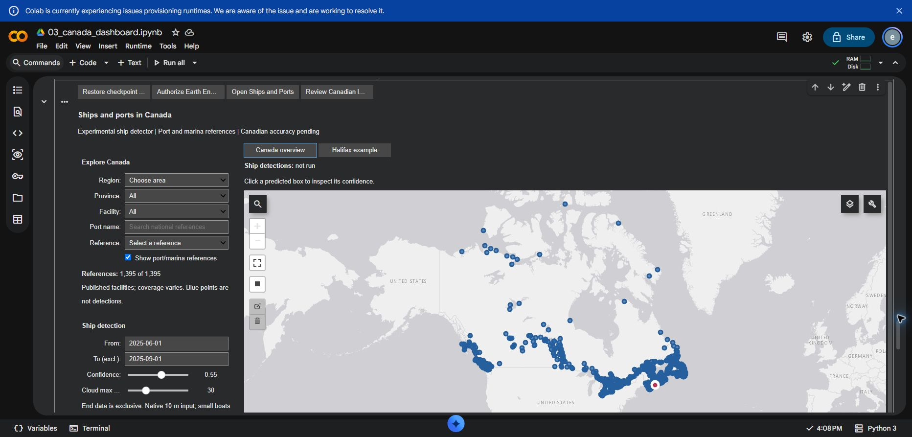

# Ships and Ports in Canada

**Student:** Oritse-Tsegbemi Eyito  
**Course:** OSS4008A - Introduction to Remote Sensing and Applications

## Project objective

Develop a reproducible Python workflow in Google Colab to detect ships in satellite imagery and display predictions on an interactive Canadian map.

Halifax Harbour is the initial demonstration area. Additional functional checks cover Vancouver and Montreal. Port markers are published reference points, separate from ship predictions; port detection and boundary mapping are not implemented.

## Folder structure

```text
students/oritse-tsegbemi_eyito/
├── README.md
├── code/
│   ├── 01_halifax_harbour_baseline.ipynb
│   └── 02_ships_ports_detection.ipynb
├── data/
└── results/
```

The notebooks generate supporting Python modules, dataset records and outputs inside this folder. The full training dataset is downloaded by code rather than committed to GitHub. Some newer results and the trained checkpoint remain in the private project backup pending upload.

## Notebooks

### 01_halifax_harbour_baseline.ipynb

Establishes the initial Halifax imagery workflow:

- Connects to Google Earth Engine.
- Searches Sentinel-2 imagery.
- Selects a dated observation.
- Displays imagery and reports coverage.
- Saves image records, study-area geometry, metadata and a PNG preview.

### 02_ships_ports_detection.ipynb

Implements the detection and assessment workflow:

- Downloads and verifies an existing annotated vessel dataset.
- Converts source bounding boxes to Labelme rectangle JSON.
- Separates training, validation and test images by geographic tile.
- Fine-tunes a PyTorch Faster R-CNN detector.
- Evaluates predictions on held-out images.
- Connects satellite imagery retrieval to model inference.
- Displays ship predictions on a Canada-centred interactive map.
- Saves PNG, CSV, GeoJSON and scene metadata.
- Produces error reports and validation threshold comparisons.
- Downloads Canadian aerial imagery for separate annotation review.

## Data and model

The training source is the SEN2MS Vessel Bounding Boxes dataset by Earle and Seto, distributed under CC BY 4.0:

https://doi.org/10.5281/zenodo.15571607

The prepared dataset contains:

| Partition | Images | Ship boxes |
| --- | ---: | ---: |
| Training | 1,430 | 935 |
| Validation | 544 | 320 |
| Test | 399 | 89 |
| Total | 2,373 | 1,344 |

Images are grouped by source MGRS tile before splitting. Exact RGB duplicates are removed, and source cloud categories above 1 are excluded.

Training samples are balanced between positive and negative images. Validation and test retain their eligible images.

The detector uses an ImageNet-pretrained ResNet18 backbone with a feature pyramid and small-object anchors. Validation AP50 selects the checkpoint.

The source training imagery is Sentinel-2 Level-1C at 10 m resolution. The detection map uses `COPERNICUS/S2_HARMONIZED` to match that processing level. Its contrast stretch approximates the source preprocessing, which remains a limitation.

## Evaluation

The original 20-epoch ResNet18 experiment produced these held-out test measurements:

| Measure | Result |
| --- | ---: |
| Test images | 399 |
| Ground-truth ship boxes | 89 |
| AP50 | 0.2434 |
| AP50:95 | 0.1039 |
| Precision at confidence 0.30 and IoU 0.50 | 0.3913 |
| Recall at confidence 0.30 and IoU 0.50 | 0.3034 |
| True positives | 27 |
| False positives | 42 |
| False negatives | 62 |

These measurements apply to the non-Canadian source dataset. They do not establish Canadian detection accuracy.

A later threshold analysis selected confidence 0.55 using validation F1. On the reloaded checkpoint, test precision was 0.4615 and recall was 0.2697 at that threshold. This trades recall for precision and does not establish an overall accuracy improvement. Small differences from training-time results can occur after half-precision checkpoint storage and reloading.

A separate four-epoch hard-negative refinement did not improve validation AP50. The original checkpoint was preserved.

## Interactive map

The notebook provides:

- Canada overview.
- Halifax demonstration area.
- Coordinate entry and rectangle selection.
- Imagery loading and ship-detection buttons.
- Adjustable confidence threshold.
- Prediction confidence and acquisition details.
- Optional detection after map movement at a bounded zoom and area.
- Separate visibility controls for port reference points.

Requests are restricted to small areas to limit computation. New imagery retrieval applies a scene-cloud filter and a matching pixel-cloud probability screen. Areas with insufficient clear pixels are rejected.

Predictions are saved as:

- PNG preview.
- CSV containing prediction confidence and coordinates.
- GeoJSON bounding polygons.
- JSON containing source imagery, processing settings and run metadata.

A zero prediction count does not prove that an area contains no ships.

## Canadian case checks

Four functional runs were completed:

- Halifax Harbour, summer 2025.
- Halifax Harbour, autumn 2025.
- Vancouver, summer 2025.
- Montreal, summer 2025.

Checks covered imagery retrieval, inference, matching export counts, PNG integrity and geographic output handling. A date range without imagery was also rejected as expected.

These checks verify operation of the pipeline, not detection accuracy.

Higher-resolution aerial previews were also downloaded for Hamilton, Toronto and Kingston from the Ontario imagery service. Source footprints, attribution and georeferencing accompany the images.

The aerial images are for separate annotation and model-development work. They are not treated as compatible inputs to the current 10 m detector.

## Running in Google Colab

1. Open the required notebook in Google Colab.
2. Select a T4 GPU runtime for model training.
3. Run the professor’s GitHub clone/pull setup when working in the course repository. Enter the token only in the hidden prompt.
4. Run the dependency and project-path cells.
5. Restore the existing checkpoint before the training cell if reusing the trained model. Otherwise, the notebook starts a new training run.
6. Complete Earth Engine authentication when prompted.
7. Run the map cells and inspect a demonstration area.
8. Save notebook editor changes using **File > Save a copy in GitHub**.
9. Use the professor’s commit, pull/rebase and push workflow for generated files.

Keep all repository work inside `students/oritse-tsegbemi_eyito/`.

Without a cloned repository, the detection notebook uses temporary storage under `/content/phase2_work/students/oritse-tsegbemi_eyito/`. Files in a Colab runtime must be backed up before the session ends.

## Current limitations and remaining work

- The detector still produces false positives and misses ships.
- Small vessels may not be distinguishable at 10 m resolution.
- Canadian images have not yet received checked ship annotations.
- Empty annotation templates are explicitly unannotated and must not be used as negative training examples.
- Cloud screening is imperfect and can exclude bright ships.
- Port markers are historical reference points, not detected ports or mapped port boundaries.
- Connection to the shared course dashboard remains pending.
- Additional independent validation and higher-resolution model development are needed.

## Weekly progress log

### Week of Nov 9–15, 2026 | Progress 2

- **Meeting feedback:** Expand the dataset beyond Halifax to cover Canada and prepare an interactive UI with ship detection integrated.
- **Done:** Added 1,395 port and marina reference records from Statistics Canada ODI v2 across 12 provinces and territories. Yukon remains a gap in this source. The map displays facility points alongside separate ship predictions.
- **Done:** Built the standalone Colab dashboard. **Canada overview** resets the map. **Region**, **Province**, **Facility**, **Port name** and **Reference** help browse facilities and select a study area. **Pick area on map**, the rectangle tool and coordinate fields set the detection area. Date, cloud and confidence controls configure the request.
- **Done:** **Restore checkpoint / project ZIP** loads the trained model and saved files. **Authorize Earth Engine** enables live imagery access. **Open Ships and Ports** rebuilds the view. **Load imagery** previews an observation, **Detect ships** runs the model, and the optional movement toggle runs detection after the map moves at zoom 15 or closer. **Saved run** opens archived results, **Download current result** exports PNG, CSV, GeoJSON or metadata, and **Review Canadian labels** opens the box review panel.
- **Problems and fixes:** Earth Engine authorization failed initially and succeeded on retry. Five Colab dashboard checks passed. The November 9 Halifax demo produced six experimental predictions at a confidence threshold of 0.55. Three Hamilton candidate boxes were saved as a draft and still need review.
- **Next:** Rerun the live demo for November 23, review Canadian ship labels, measure performance on separate Canadian scenes and confirm the shared dashboard interface.

**Canada overview**



**Halifax inference demo**


### Week of Nov 2–8, 2026

- **Done:** Completed the Halifax Sentinel-2 baseline with imagery selection, coverage checks, scene metadata and a PNG export. Added the baseline notebook and outputs to the course repository.
- **Done:** Prepared 2,373 source images and 1,344 ship boxes, split by geographic tile. Trained a Faster R-CNN vessel detector in Colab and measured AP50 of 0.243 on the held-out source benchmark.
- **Done:** Connected Earth Engine imagery to the detector and verified exports for four functional runs across Halifax, Vancouver and Montreal. Added error analysis and pixel-level cloud screening.
- **Problems and fixes:** The hard-negative experiment did not improve validation performance, so I kept the existing checkpoint. Canadian detection accuracy still requires checked labels and an independent test.
- **Next:** Add national port reference data and prepare a Colab dashboard for selecting imagery and running detections.

## File management

- Keep each committed file below 50 MB.
- Exclude large raw imagery, full converted training datasets and ZIP backups.
- Include download code and source references for reproducibility.
- Never commit passwords, GitHub tokens or other credentials.
- Keep the project description and weekly progress log in this README.

## References

- [Course repository and workflow](https://github.com/AdityaR28/OSS4008A---Introduction-to-Remote-Sensing-and-Applications)
- [Earle and Seto vessel dataset](https://doi.org/10.5281/zenodo.15571607)
- [PyTorch object-detection tutorial](https://docs.pytorch.org/tutorials/intermediate/torchvision_tutorial.html)
- [Earth Engine Sentinel-2 Level-1C](https://developers.google.com/earth-engine/datasets/catalog/COPERNICUS_S2_HARMONIZED)
- [Sentinel-2 cloud probability](https://developers.google.com/earth-engine/datasets/catalog/COPERNICUS_S2_CLOUD_PROBABILITY)
- [Ontario imagery catalogue](https://geohub.lio.gov.on.ca/maps/lio::ontario-imagery-web-map-service-oiwms/about)
- [Open Government Licence Ontario](https://www.ontario.ca/page/open-government-licence-ontario)
- [SMDG terminal reference records](https://github.com/smdg-org/Terminal-Code-List/blob/master/SMDG%20Terminal%20Code%20List.csv)
